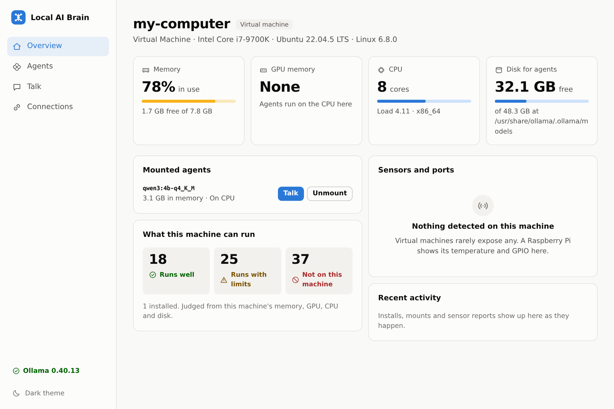
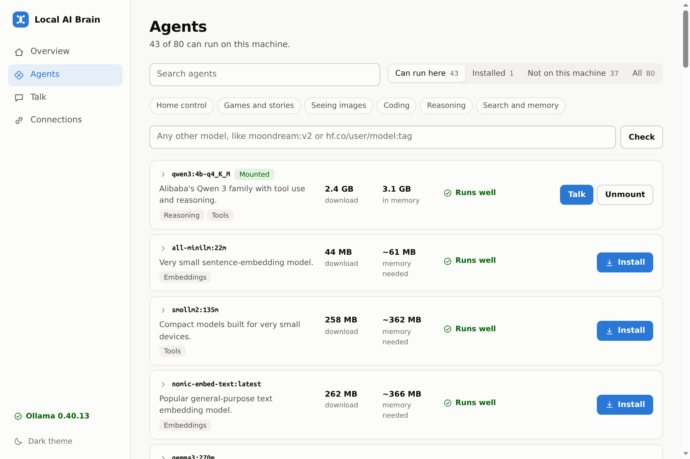
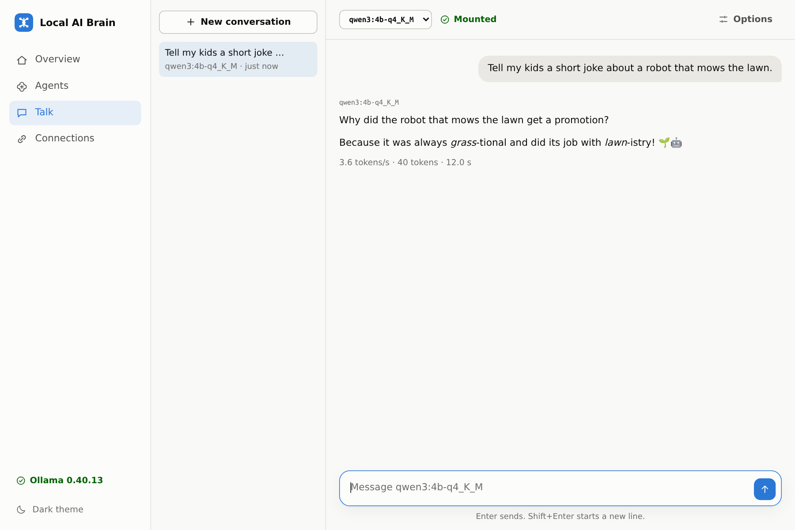

# Local AI Brain

Run, manage and talk to local AI agents on any Linux machine, from a Raspberry Pi to a GPU server.
It is one program with a web dashboard, an HTTP API, a command line and a small Python client, so
your house controllers, kids' games and sensors can all share the same agents.

- **Plug and play.** It needs Python 3.15 and nothing else: no `pip install`, no third-party packages.
  If Ollama is missing, it installs it, with or without root.
- **Knows your machine.** It reads RAM, VRAM, CPU, disk and sensors, including the limits Docker and
  Kubernetes impose, then tells you which agents can run here and why the others can't.
- **Exclusively local.** Ollama's cloud models look like local ones, so they are refused by name and
  by what Ollama reports about them. The dashboard loads nothing from the internet.



## Start

```bash
./run.sh
```

Then open <http://127.0.0.1:8484>. If Ollama is missing, the dashboard offers to install it.

On a headless machine, this installs Ollama unattended and opens the brain to your network:

```bash
./run.sh serve --host 0.0.0.0 --auto-install
```

Listening on the network turns on the API token automatically. Run `./run.sh token` to see it.

## A quick tour

The brain sits between your programs and Ollama. The dashboard and your programs use the same API:

```
Dashboard, games, sensors, house controllers
                    |
                 HTTP API
                    |
             Local AI Brain      manages agents, keeps history and device readings
                    |
                  Ollama         runs the models on this machine
```

These screenshots come from the CPU-only test machine with 8 GB of RAM, so your numbers will differ.

### Overview

The page at the top of this README shows what the machine has, which agents are in memory, and how
many agents it can run.

### Agents

Shows what can run on this machine and why. From here you can install, mount, unmount and uninstall
agents, or check any other model by name.



### Talk

Chat with any installed agent. Conversations are saved, and each reply shows its speed.



### Connections

Lists everything that has reported to the brain, with its latest readings. `Live` means it reported
in the last 5 minutes. The page also gives you code to connect something new.


A program appears here once it sends a reading. One that only chats with agents isn't listed.

## What "agent" means here

An agent is a model plus a lifecycle, and it moves through these states:

| Action | What happens | Claims |
|---|---|---|
| **Install** | Downloads it | Disk |
| **Mount** | Loads it into memory and pins it there, ready to answer straight away | RAM or VRAM |
| **Unmount** | Releases the memory but keeps the files | Disk |
| **Uninstall** | Deletes the files | Nothing |

Mounts survive restarts: whatever was mounted comes back when the brain starts again.

Talking to an agent that isn't mounted is refused unless you send `"auto_mount": true`. Mounting
takes a lot of memory, so a stray sensor script should never do it by accident.

## Which agents can run here?

Each agent gets one of these verdicts, along with its reasons:

| Verdict | Meaning |
|---|---|
| Runs well | Fits, and should feel responsive |
| Runs with limits | Fits, but will be slow, split across GPU and CPU, or memory is short right now |
| Not on this machine | Too big for memory or disk, an unsupported CPU, or a cloud model |
| Size unknown | Not in the catalog and the registry can't be reached |

The catalog holds 80 agents with sizes read from Ollama's registry. Any other name works too:
type `moondream:v2` or `hf.co/user/model:tag` into the Agents page, and its real download size is
looked up before you commit to it.

Memory estimates are calibrated on real loads (2.62 GB on disk became 3.31 GB in RAM). They are
estimates: once an agent is mounted, you see the real number instead.

## Command line

```bash
./run.sh hardware                         # what this machine can do
./run.sh agents                           # what can run here (--all includes what can't)
./run.sh install qwen3:4b-q4_K_M
./run.sh mount qwen3:4b-q4_K_M
./run.sh chat qwen3:4b-q4_K_M "Hello"     # leave out the message for a conversation
./run.sh unmount qwen3:4b-q4_K_M
./run.sh uninstall qwen3:4b-q4_K_M
./run.sh status                           # is Ollama installed and running?
./run.sh ollama install                   # also: --method official|rootless
```

## Connecting your own programs

Before you build a client, read the [client guide](docs/client-guide.md). It covers what the brain
does, what it expects from clients, what they can expect back, and best practices, especially for IoT.

### Python

`brain/sdk.py` has no dependencies, so you can copy that one file onto any machine with Python 3.15.

```python
from brain.sdk import BrainClient

brain = BrainClient("http://127.0.0.1:8484")          # token=... when on a network

brain.mount("qwen3:4b-q4_K_M")
print(brain.ask("qwen3:4b-q4_K_M", "Tell my kids a joke about robots."))

for event in brain.stream("qwen3:4b-q4_K_M", message="Tell a story", think=False):
    if event["type"] == "content":
        print(event["text"], end="", flush=True)

brain.report("kitchen", name="Kitchen", temperature=(21.5, "°C"), window_open=False)

for event_type, data in brain.events():               # runs forever
    print(event_type, data)
```

Working examples, run from this folder:

```bash
python3.15 -m examples.sensor_reporter --once
```

```bash
python3.15 -m examples.house_controller qwen3:4b-q4_K_M "It's dark in the kitchen"
```

```bash
python3.15 -m examples.story_game qwen3:4b-q4_K_M
```

### Example web services

[Two complete web services](examples/httpServicesExamples/README.md) show how to build on the brain
without changing it: a room comfort advisor, and a kids' game where an agent drives a robot mower.

[](examples/httpServicesExamples/README.md)

### HTTP

Anything that can make an HTTP request can connect, including a microcontroller. All paths are under
`/api/v1`. Add `Authorization: Bearer <token>` when a token is required.

```bash
curl http://127.0.0.1:8484/api/v1/agents/qwen3:4b-q4_K_M/chat \
  -d '{"message": "Is it warm enough to open a window?", "sensor_context": true, "think": false}'
```

```bash
curl http://127.0.0.1:8484/api/v1/devices/kitchen/readings \
  -d '{"name": "Kitchen", "readings": [{"metric": "temperature", "value": 21.5, "unit": "°C"}]}'
```

| Method and path | Purpose |
|---|---|
| `GET /health` | Liveness check. Public. |
| `GET /hardware` | The full machine profile |
| `GET /runtime` | Ollama's status and install options |
| `POST /runtime/install`, `POST /runtime/start` | Set up or start Ollama |
| `GET /agents` | Every agent, with state and verdict |
| `GET /agents/{name}` | One agent. Any name works, not just catalog ones. |
| `POST /agents/{name}/install`, `/mount`, `/unmount` | Lifecycle. Add `?wait=1` to block until done. |
| `DELETE /agents/{name}` | Uninstall |
| `POST /agents/{name}/chat` | Talk (fields below) |
| `POST /agents/{name}/embed` | Embeddings: `{"input": "text"}` |
| `GET /conversations`, `GET`, `PATCH`, `DELETE /conversations/{id}` | Stored history |
| `GET /devices`, `DELETE /devices/{id}` | Connected devices |
| `POST /devices/{id}/readings`, `GET /devices/{id}/readings` | Report and read sensor data |
| `GET /jobs`, `GET /jobs/{id}`, `DELETE /jobs/{id}` | Background work. `DELETE` cancels. |
| `GET /events` | Live server-sent events: `job.updated`, `agent.changed`, `runtime.changed`, `device.reading` |

Chat fields, of which you send either `message` or `messages`:

| Field | Meaning |
|---|---|
| `message` | One new turn |
| `conversation_id` | With `message`, keeps history here under any name you like, such as `"kitchen-speaker"` |
| `messages` | The full history, managed by you. Needed for tool-calling loops. |
| `system` | Instructions. In a conversation, leaving it out keeps the stored ones and `null` clears them. |
| `stream` | `true` for one JSON event per line: `start`, `thinking`, `content`, `tool_calls`, `done`, `error` |
| `think` | Reasoning on or off. **Leaving it out uses the model's default, which can be very slow on a CPU.** |
| `sensor_context` | Gives the agent the latest device readings |
| `tools`, `format`, `options`, `images` | Passed to Ollama: function calling, JSON schema output, sampling, vision |
| `auto_mount` | Mount first if needed |

Unknown fields are rejected, so a typo gets an error rather than being silently ignored.

## Settings

Later layers win: defaults, then `~/.config/local-ai-brain/brain.toml`, then `BRAIN_*` variables, then
command line flags. Each setting below is a TOML key, or the same name in capitals after `BRAIN_`.

| Setting | Default | Meaning |
|---|---|---|
| `host`, `port` | `127.0.0.1`, `8484` | Where to listen |
| `ollama_url` | `http://127.0.0.1:11434` | Where Ollama is. Also read from `OLLAMA_HOST`. |
| `data_dir` | `~/.local/share/local-ai-brain` | Database, token, rootless Ollama |
| `auth` | `auto` | `auto` needs a token once on a network. Also `always` and `off`. |
| `token` | generated | The API token |
| `allowed_hosts` | none | Extra host names for a brain listening only on loopback |
| `allowed_origins` | none | Web pages allowed to call the API, such as a game on `http://games.local:3000` |
| `auto_start_ollama` | `true` | Start Ollama at startup if it is installed |
| `auto_install_ollama` | `false` | Install Ollama at startup if it is missing |
| `restore_mounts` | `true` | Mount again what was mounted before |
| `reading_retention_days` | `30` | How long to keep sensor history |
| `max_body_bytes` | `33554432` | Largest request, images included |

If Ollama runs on another machine, its hardware isn't visible from here, so the verdicts describe
this machine rather than that one.

## Deploying

- **systemd:** [deploy/local-ai-brain.service](deploy/local-ai-brain.service)
- **Docker:** `docker compose -f deploy/docker-compose.yml up --build`
- **Kubernetes:** [deploy/kubernetes.yaml](deploy/kubernetes.yaml)

The containers run the brain and Ollama together on one volume, rather than as two containers. That
way the limits the brain measures are the ones Ollama actually lives under, and a pod limited to
8 GiB on a large server is only offered agents that fit in 8 GiB.

## Security

The API can install software and may end up controlling a house, so:

- It listens only on this machine by default. Listening on a network turns on a token automatically,
  stored in a file only you can read.
- **DNS rebinding** is blocked: a loopback brain refuses unexpected `Host` headers.
- **Cross-site requests** are blocked: any web page you visit could otherwise call `localhost`.
  Requests with a foreign `Origin` are refused unless you allow that origin.
- **Agent names can't steer network requests.** Registry lookups only go to a fixed list of hosts.
- **Downloaded archives can't escape their folder,** thanks to `tarfile`'s `data` filter, and an
  interrupted install can't be mistaken for a good one.
- **Sensors can't inject prompts.** Device text is flattened onto one line and shortened before an
  agent sees it, and is labelled as data. This reduces the risk rather than eliminating it, so an
  agent's replies should never directly trigger anything dangerous. Put your own checks in between,
  as `examples/house_controller.py` does.
- The dashboard's Content-Security-Policy allows nothing from other origins, and agent output is
  only ever inserted as text.

Traffic is plain HTTP, so anyone able to watch your network can read it, token included. Use a
trusted network, or put a TLS reverse proxy in front.

## Architecture

Dependencies point inward. Nothing in `domain` knows that Ollama, HTTP or SQLite exist.

```
brain/
  domain/           Rules and values: agents, compatibility, hardware, conversations
  ports.py          The small interfaces that services depend on
  services/         Use cases: AgentManager, ChatService, DeviceHub, RuntimeManager, JobRunner
  infrastructure/   Adapters: hardware probes, Ollama client and installers, SQLite, event bus
  interfaces/       Ways in: HTTP API, CLI
  container.py      The one place that chooses concrete classes
  sdk.py            A dependency-free client for your own programs
  web/              The dashboard: plain JavaScript modules and CSS, with no build step
```

How the SOLID principles show up, with what you would do to extend each:

| Principle | Where | To extend |
|---|---|---|
| **Single responsibility** | One hardware probe per source, one controller per resource | Change one thing in one place |
| **Open/closed** | `CompatibilityRule`, `Probe`, `RuntimeInstaller`, `Command`, `Response` | Add a class to a list, editing nothing else |
| **Liskov substitution** | Either installer works wherever `RuntimeInstaller` is expected; each probe returns the same shape | Tests swap in fakes freely |
| **Interface segregation** | `ModelStore`, `ModelLoader`, `ChatBackend` and `RuntimeProbe` are separate, although one class implements all of them | Replace only the part you need |
| **Dependency inversion** | Services take `ports.py` protocols, wired only in `container.py` | Supporting a runtime other than Ollama touches `infrastructure/ollama` and `container.py` |

### Python 3.15 features used

Taken from the 3.15 "What's New" and the 3.15.2 changelog.

| Feature | Used for | Where |
|---|---|---|
| Lazy imports (PEP 810) | `sqlite3`, `ssl`, `tarfile` and others load only when needed, so a Pi starts faster | `lazy import` throughout |
| `frozendict` (PEP 814) | Immutable events and options, safely shared across threads | `domain/events.py`, `domain/conversation.py` |
| `sentinel` (PEP 661) | "Not provided" versus `None`, which clears a stored prompt | `domain/conversation.py` |
| Comprehension unpacking (PEP 798) | Flattening results from many rules and probes | `domain/compatibility.py`, `hardware/inspector.py` |
| Closed `TypedDict` (PEP 728) | One class serves as static type and runtime schema, and rejects typos | `interfaces/http/schemas.py`, `validation.py` |
| `json` `array_hook` | Deeply immutable catalog data | `infrastructure/catalog.py` |
| `Path.mkdir(parent_mode=)` | A private data folder, with sensible permissions on the folders above it | `infrastructure/storage.py`, `config.py` |
| Template strings (PEP 750, 3.14) | Trusting a prompt's literal text but not the values placed into it | `services/devices.py` |
| `except A, B:` (PEP 758, 3.14) | The new form, without parentheses | `hardware/cpu.py` and others |
| Deferred annotations (PEP 649, 3.14) | Forward references without quotes or `__future__` imports | `event_bus.py`, `http/server.py` |
| `uuid.uuid7` (3.14) | Time-ordered IDs for jobs and events | `services/jobs.py`, `domain/events.py` |
| Generics and `type` (PEP 695) | `Probe[T]`, `validate[T]` and type aliases | `ports.py`, `validation.py` |

`asyncio.TaskGroup.cancel()` is new in 3.15 too, but it isn't used. The server deliberately uses one
thread per connection, which keeps the streaming code sequential and is enough at home scale.

`tarfile` is used through its `data` filter, which 3.15.2 hardened further (CVE-2026-114583). Some
Python 3.15 builds, including the one this was developed on, lack the `_zstd` module, so unpacking
Ollama falls back to the `zstd` command in that case.

## Tests

```bash
python3.15 -X dev -W error::DeprecationWarning -m unittest discover -s tests -t .
```

The tests need no network, Ollama or GPU. They run against a fake Ollama speaking real HTTP, a real
SQLite database and real `.tar.zst` archives, with pretend `/proc` and `/sys` folders standing in for
hardware.

### What has been checked for real, and what hasn't

Checked on an Ubuntu 22.04 x86-64 VM, CPU only, 8 GB RAM, with Ollama 0.40.13:

- The complete agent lifecycle, chat, streaming, tool calls, embeddings, sensor context and restored
  mounts, against real Ollama
- The rootless install, using the real 1.5 GB download, from both the CLI and the dashboard
- Every dashboard screen, in light and dark themes and at phone width
- `pip install .` into a clean virtual environment

**Not yet run on real hardware or infrastructure,** only against simulated inputs:

- Raspberry Pi and other ARM boards, Jetson, and NVIDIA or AMD GPUs
- Real container limits: the cgroup logic is tested against pretend files only
- The official installer script, as this machine's sudo needs a password
- The Docker, Compose, Kubernetes and systemd files, which have never been run

Expect speed verdicts on those machines to need tuning. The thresholds in
`domain/compatibility.py` were calibrated on this one machine.
# localbrain
# localbrain
# localbrain
