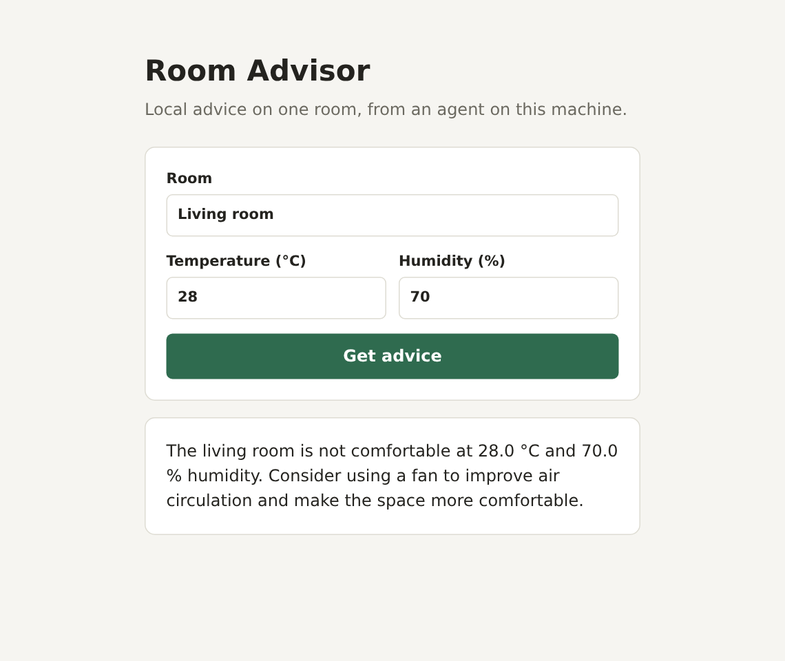
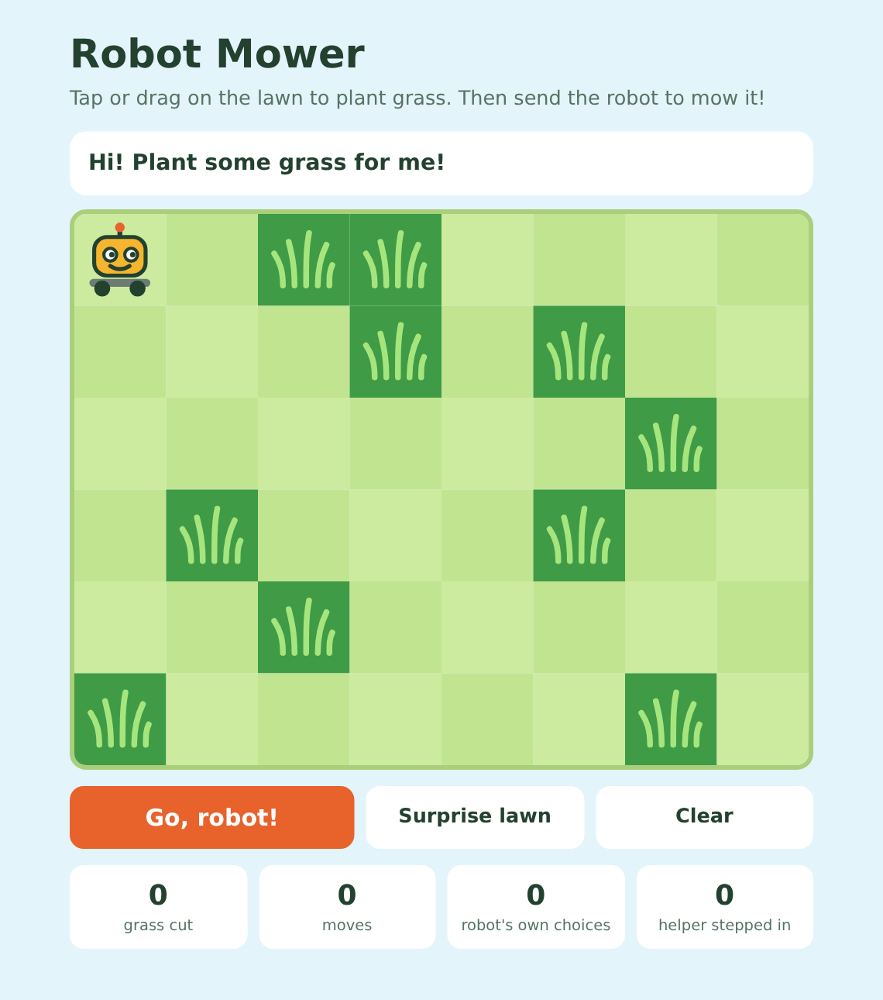
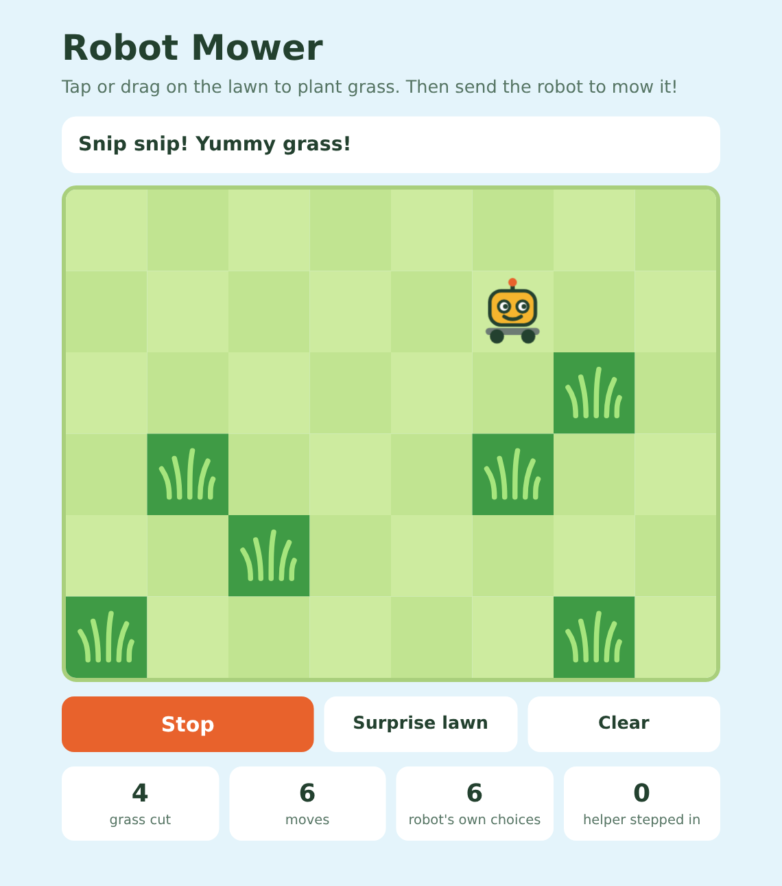
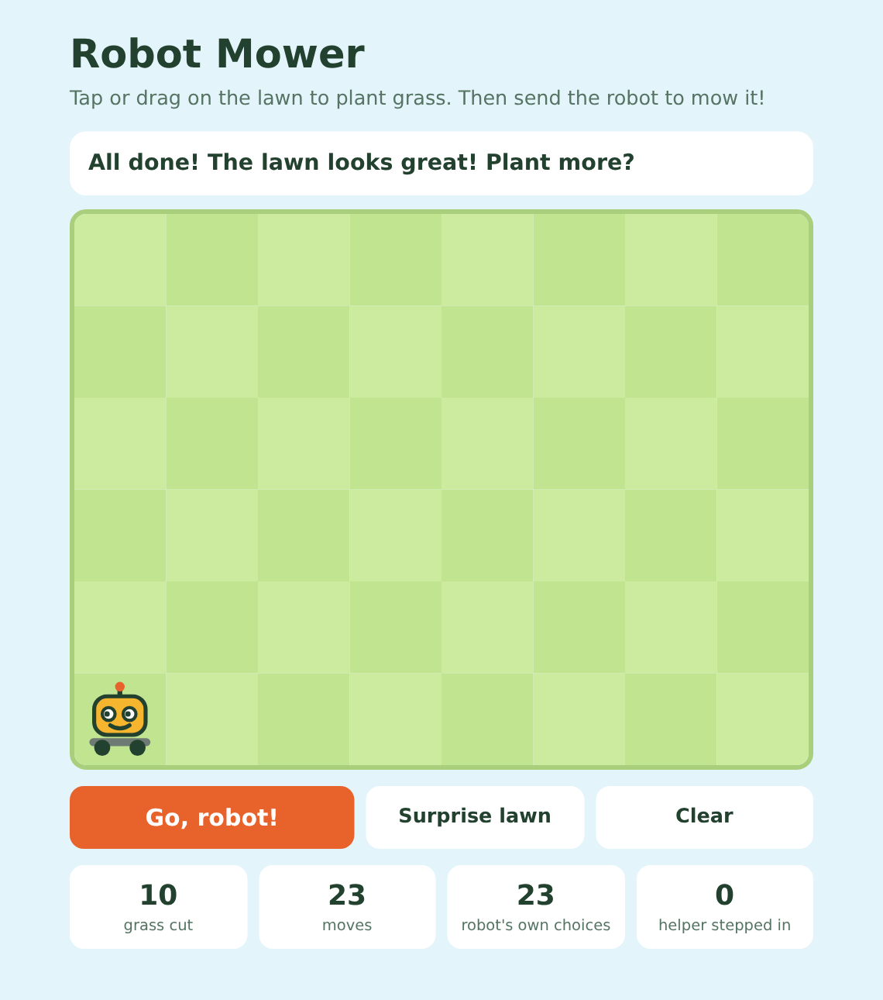
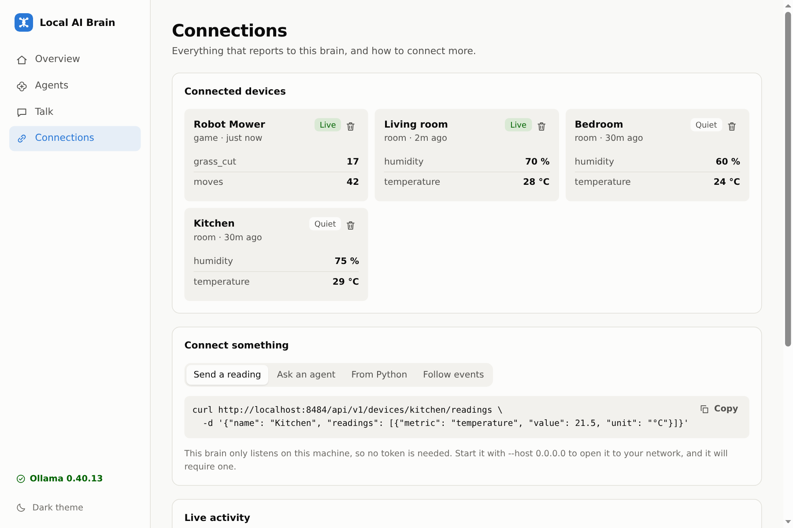

# Example web services

These are small web services that use Local AI Brain as their "brain". Each one is a single Python
file containing both its server and its web page, with nothing to install.

| Service | What it does | Address |
|---|---|---|
| [Room Advisor](#room-advisor) | Tells you how comfortable a room is | <http://127.0.0.1:8585> |
| [Robot Mower](#robot-mower) | A kids' game where an agent drives a robot that cuts grass | <http://127.0.0.1:8586> |

Neither service needed any change to the brain. **Services adapt to the brain, and the brain doesn't
adapt to each service.** Both use the same public API that anything else can use.

## Before you start

You need the brain running with at least one chat agent installed. From the top folder of this
project, start the brain:

```bash
./run.sh
```

Then, in a second terminal, install an agent if you don't have one yet:

```bash
./run.sh install qwen3:4b-q4_K_M
```

Both services choose an installed agent for you and load it into memory if it isn't mounted yet.

## Room Advisor



Enter a room's name, temperature and humidity, then press **Get advice**. You type the readings by
hand here, but a real sensor could send them instead.

```bash
python3.15 -m examples.httpServicesExamples.room_advisor
```

Then open <http://127.0.0.1:8585>.

### How it works

1. The page sends the readings to the service, which checks they make sense.
2. The service reports them to the brain, so the room appears under **Connections**.
3. The service asks the agent for advice and passes the words to the page as they arrive.

The advice comes from a small model and can be generic, so treat it as a suggestion.

## Robot Mower

| 1. Plant grass | 2. The agent drives | 3. All done |
|---|---|---|
|  |  |  |

Tap or drag on the lawn to plant grass, or press **Surprise lawn**. Then press **Go, robot!**. You can
keep planting while the robot mows.

```bash
python3.15 -m examples.httpServicesExamples.robot_mower
```

Then open <http://127.0.0.1:8586>.

### How the agent steers

Each turn, the service asks the agent for one move and lists only the moves that stay on the map:

```
Your moves:
- down: nearest grass is then 2 steps away
- right: cuts grass
Pick the best move.
```

The service also requires a JSON answer limited to those moves, such as `{"move": "right"}`, so the
agent can't drive into a wall or reply with something unusable.

**The service does the map calculations, and the agent chooses between the options.** When a test
gave the agent only the raw grass coordinates, it cut 0 of 7 tiles in both games and kept driving
into walls.

### The helper

After two moves that don't get closer to the grass, the agent can only pick moves that do until it
cuts the next patch, so the robot can't wander forever. If the agent's answer can't be used, the
service picks a move that gets closer instead. The **helper stepped in** score counts these moves,
and **robot's own choices** counts the rest.

### How well it plays

| Game | Grass cut | Moves | Helper stepped in |
|---|---|---|---|
| First | 7 of 7 | 17 | 0 |
| Second | 10 of 10 | 23 | 0 |

These two games were played with `qwen3:4b-q4_K_M` on an 8-core CPU with no GPU, at roughly 5 to 6
seconds per move. Other lawns, models and machines may behave differently.

## How each service uses the brain

Both connect through [`brain/sdk.py`](../../brain/sdk.py), and these are the API calls behind it:

| API call | Room Advisor | Robot Mower |
|---|---|---|
| `GET /api/v1/agents` | Picks an installed agent | Picks an installed agent |
| `POST /api/v1/agents/{name}/chat` | Streams the advice as text | Gets one move as JSON |
| `POST /api/v1/devices/{id}/readings` | Reports the room's temperature and humidity | Reports total moves and grass cut |

Reports are what make a service appear under **Connections**. Chat requests alone don't.



## Options

Both services accept the same options:

| Option | Meaning | Default |
|---|---|---|
| `--port` | The port this service listens on | `8585` for Room Advisor, `8586` for Robot Mower |
| `--brain` | Where the brain is | `http://127.0.0.1:8484` |
| `--agent` | Which agent to use | An installed agent, preferring one that is mounted |

If the brain requires a token, set `BRAIN_TOKEN` before starting the service. `./run.sh token` shows
the token:

```bash
BRAIN_TOKEN=your-token python3.15 -m examples.httpServicesExamples.robot_mower
```

Both services only accept connections from their own machine, and they have no login. If you put them
on a network, add your own access control.

## Building your own

1. **Start with one file.** Copy `room_advisor.py` if you want text answers, or `robot_mower.py` if
   the agent's answer has to control something.
2. **Use the public API.** If it seems to be missing something, look for a way to do it in your
   service before changing the brain.
3. **Give the agent small decisions.** Work out the facts in your code and let the agent choose
   between clear options. Small models are much more reliable this way.
4. **Limit what it can answer.** Use `format` with a JSON schema, then check the answer in your code
   before acting on it.
5. **Plan for a bad answer.** Decide what happens if the agent is wrong, unavailable or slow,
   especially if your service controls something real.
6. **Report what your service is doing.** Send readings with `brain.report(...)` so it appears under
   **Connections**.

The [main README](../../README.md#connecting-your-own-programs) lists every API call and chat field.
